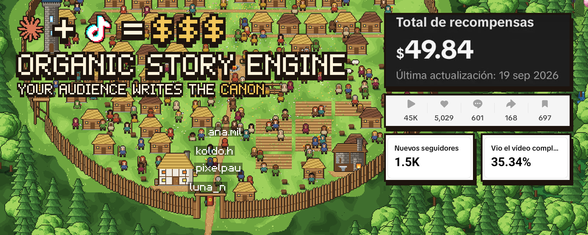

<p align="center"></p>

**Organic Story Engine** is a kit for running a short-form series where every follower is a character,
every comment is a story request and every episode ends with a vote that changes the world for good.

The machine does what machines are good at: pixel art, maps, sound, narration, timing, bookkeeping.
People do what only people can: who is in the story, what they ask for, what they choose.

It is built to be driven by an AI coding agent. Every workflow is a [Claude Code](https://claude.com/claude-code)
skill, and the repo ships with a starter world: a pixel-art medieval village with original sprites, a
generated map and a blank canon, ready to be forked into any theme.

## The loop

```
   follow ─────────► CENSUS ──────────► a citizen with a number, a role and a look
                        │                         │
   comment ────────► REQUESTS ──────► the script answers the most specific, most liked ones
                        │                         │
                        ▼                         ▼
                      CANON  ◄──────────  EPISODE (40-50 s) ──► ends with a VOTE
                        ▲                                            │
                        └──────────── the result is written ◄────────┘
                                      and shown in the first wide shot
                                      of the next episode
```

Three promises keep it alive:

1. **You are in it.** Follow, and you get a citizen number, a job and a face that stays the same in every video.
2. **You are heard.** Your first comment on a video is stored word for word, and the best ones become scenes with your name on screen.
3. **Your vote is real.** The first wide shot of the next episode shows what you chose, and the canon never quietly reverses it.

Read [how it works](docs/how-it-works.md) and [the mechanics](docs/mechanics.md) for the full idea: votes,
the two long-term routes, threshold consequences, and the closed short stories built from a single comment.

## Quickstart

You need Python 3.10+ with `numpy` and `Pillow`, Node 18+, `ffmpeg`, and an ElevenLabs key for narration.

```bash
git clone https://github.com/adriaansaeez/organic-story-engine && cd organic-story-engine
pip install numpy pillow
cp .env.example .env              # ELEVENLABS_API_KEY, ELEVENLABS_VOICE_ID
```

Make a first episode in the starter village:

```bash
cp -R templates/episode my-series/ep01
engine/tools/sync_world.sh examples/village/world my-series/ep01
# write my-series/ep01/narration.json, then:
python3 engine/tools/voice.py my-series/ep01/narration.json
cd my-series/ep01 && npm run check
npx --yes hyperframes@0.9.17 render -q delivery -o ../../output/ep01.mp4
```

Or let the agent do it: the `ose-episode` skill walks from the canon to a rendered video.

Start your own series: open the repo in Claude Code and ask for a new world. The `ose-new-world` skill
asks for your theme and builds the palette, sprites, roles, routes and the first canon with you.

## Skills

| Skill | What it does |
| --- | --- |
| `ose-new-world` | Turns a theme into a world: palette, scale, sprites, roles and quotas, routes, seed canon |
| `ose-census` | Adds new followers as citizens, oldest first, so numbers never move |
| `ose-comments` | Captures a video's comments and stores each person's first one as a request |
| `ose-episode` | Next episode end to end: canon, script, shot list, voice, composition, checks, render, new vote |
| `ose-close-vote` | Writes a vote result into canon, moves the route counters, triggers threshold consequences |
| `ose-short` | A closed 30-45 s story from one comment, outside the main arc |
| `ose-voice` | ElevenLabs narration with per-line timings on the film clock |
| `ose-assets` | Sprites, scenes, maps, fog, crowds, ambience and music from code |

## What is inside

```
engine/
  runtime/     story.js: camera, actors with nameplates, pixel labels, fire light, fog, night
  tools/       generators for sprites, scenes, fog, crowds, landmarks, ambience, music, voice
  audience/    the audience database (one SQLite file) and its CLI
  capture/     a Chrome extension and in-page scripts to read follows and comments
templates/     episode and short skeletons (HyperFrames projects)
examples/
  village/     a starter world: sprites, scenes, map generator, seed canon, test fixtures
docs/          how it works, mechanics, canon, audience database, episode anatomy
.claude/skills/
```

**Everything is code and deterministic.** Each sprite is a character map on one shared palette, the map
is generated, the ambience is synthesized from a sound sheet, and every episode is an HTML page driven
by a paused, seekable GSAP timeline that [HyperFrames](https://hyperframes.heygen.com) renders to a
1080x1920 MP4. Same input, same video. The image at the top was made the same way:
`python3 docs/make_hero.py`.

**The audience is memory, not a number.** One local SQLite file remembers who arrived when, who asked
for what, and who has already been on screen. See [the audience database](docs/audience-db.md).

**Canon is a contract.** Two JSON files hold the state of the world after the last published video.
See [canon](docs/canon.md) and [anatomy of an episode](docs/episode-anatomy.md).

## Ground rules

- Comments are quoted verbatim. Only the people who asked become protagonists.
- Humour without humiliation. Anyone can be hidden from future videos with one flag.
- Requests and notes are private working data, never published.
- Platform tools are read-only. You log in yourself; the agent never types passwords or solves captchas.
- Real people and brands appear only as clearly labelled fan fiction, with original emblems.

## License

Code is MIT. The example world in `examples/village/` is CC BY-NC 4.0: adapt it for a non-commercial
series with attribution, or build your own world for anything else. See [LICENSE](LICENSE).

Claude is a trademark of Anthropic and TikTok a trademark of ByteDance; the marks in the banner come from
[Simple Icons](https://simpleicons.org) and are used only to name the tools. This project is not affiliated
with either company. The numbers in the banner are real screenshots from one video made with this kit.
